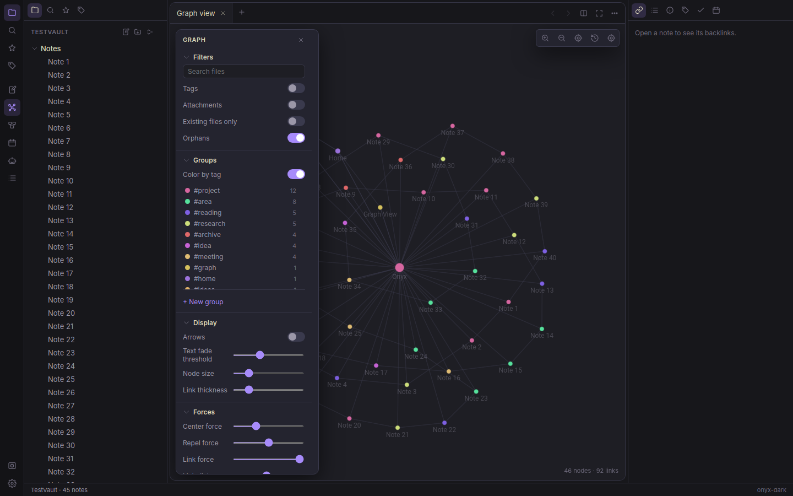

# Electron

A modern, premium markdown notes app — an Obsidian-inspired vault that comes in two
front ends over the same folder of plain `.md` files:

- **`electron`** — the terminal app (Rust + ratatui). This README.
- **[Electron Desktop](desktop/README.md)** — a TypeScript GUI (built on the Electron framework) made to match
  Obsidian: live-preview editor, WebGL graph view, canvas, and the Electron extras.
- **[Scribe](scribe/README.md)** — a pen-first notebook for macOS (Rust + SwiftUI). It runs on its
  own, and inside Electron Desktop on macOS, where an app switcher flips the window between the two.

Both read and write the same vault and the same `.onyx/` sidecar files, so you can
run them side by side.



## Features

- Interactive **start page** on launch — new note/folder, search, open recent, daily note, and **bookmarked** notes
- **Bookmarks** — pin notes (`:bookmark` or file-tree `b`); pinned notes show `★` and appear on the Home page
- Vault-based markdown notes with live file tree
- Live-rendered preview pane (headings, bold/italic, code blocks, lists, task lists, blockquotes, wikilinks, tags)
- `[[Wikilinks]]` with **inline autocomplete** (type `[[`, fuzzy-pick a note) and `Ctrl-Enter` to follow; `#tag` autocomplete too
- **Aliases** — `aliases:` in frontmatter let a note be linked/found by alternate names
- Clickable **outline** (jump to heading), `t` to **toggle task checkboxes**, and a live **word count**
- **Page properties** — Notion-style typed frontmatter shown as a clean properties block in the preview
- **Database views** — render any folder as a Notion-style table or kanban **board** keyed by frontmatter properties (`:database`/`:board`, or `t` on a folder), with sort and live filter
- **Nested-page navigation** — a breadcrumb trail in the editor and a **Pages** sidebar tab for jumping between a note's parent, child, and sibling pages (`:up` to go to the containing page)
- **Blocks** — styled **callouts** (`> [!note]`/`[!warning]`/`[!tip]`/…), **collapsible** callouts (`[!note]-`, toggled in the preview), side-by-side **columns** (`::: columns … +++ … :::`), and a **`/` slash menu** in the editor to insert any of them
- **Notion import** — `:notion import <folder>` cleans an unzipped Notion "Markdown & CSV" export into the vault (strips id suffixes, links → wikilinks, CSV databases → note folders with frontmatter + `_schema.md`)
- **Editor tabs** (`Ctrl-PgUp/PgDn`, `Ctrl-W`) and a **split view** (`:vsplit`) to read a second note beside the one you're editing
- **Editable properties** — `:props` edits a note's frontmatter inline; database **board** cards move between groups (`H`/`L`) by rewriting their property
- **Links to handwriting** — `[[scribe:…]]` links open a Scribe page, or zoom to a lassoed area of one (copy them in Scribe with ⌥⌘L, or pick a page after `[[`); linked pages show in the graph and backlinks, and `[[Note]]` typed on a page links back (macOS and iPad, see `scribe/README.md`)
- Backlinks (plus **unlinked mentions** — notes that name this one without linking it), outline (click to jump), tag, and **Pages** (parent/child) panels in the right sidebar
- Command palette (`Ctrl-P`) and quick switcher (`Ctrl-O`) with fuzzy matching
- **Command bar** (desktop, `⌘K`, or the search pill at the top of the window) — one search across note titles, the text inside notes, Scribe handwriting, commands and tags, with *Ask your vault* a Tab away; `>` lists commands only, `#` tags only, `⌘↵` opens in a new tab, and a missing note can be created from it
- **Today** (desktop, `⇧⌘D`, the Today button, or any new tab) — the home view: today's daily note to write in place, a quick-capture box (`[]` makes a task), this week's daily notes and Google Calendar events, open `- [ ]` tasks from across the vault (tick them here), and the notes and Scribe pages edited last
- **Context panel** (desktop) — the right-hand side is one panel about the open note with four views: *Linked* (notes linking here with the line they do it on, Scribe pages linked either way, unlinked mentions on request), *Outline*, *Graph* (the local graph) and *Calendar*
- Full-vault content search (`Ctrl-Shift-F`) with **`tag:` / `path:` / `line:N` operators**, and a vault-wide **task rollup** (`:tasks`) of every `- [ ]` checkbox
- Left-column **Quicknote** scratch pad and **Todo** checklist (autosaved to the vault); focus either and press `Ctrl-F` to expand it full-screen, `Esc`/`Ctrl-F` to collapse. Completed todos drop to the bottom (`Space` to check/uncheck) and auto-clear a week after they're finished
- ASCII graph view (`Ctrl-G`) centered on the current note
- Monthly calendar with daily-notes (`Ctrl-K`), plus optional **Google Calendar** events (`·` marks, `v` day agenda, two-way create/delete)
- Optional **Google Drive** browser (`:drive`) — open a Drive text file in the editor (save uploads it straight back, two-way), open a PDF/image in your system viewer, or `u` to upload the open note as a new Drive file; plus **Google Tasks** merged into the Todo pane
- Optional **local AI assistant** (`Ctrl-A` / `:ai`) — a streaming chat over your notes powered by a **local LLM via Ollama** (e.g. Gemma); the open note is sent as context, plus `:summarize`, **`:ask` (semantic RAG over your whole vault, with cited sources)**, **`:rewrite` (AI-rewrite a paragraph/selection/note in place, undoable)**, and **inline autocomplete** (ghost text, Tab to accept). It even knows Electron's own shortcuts. No cloud, no keys. See `docs/AI.md`
- Vim-style modal editing — normal/insert/**visual** (line-wise select → yank `y` / delete `d` / paste `p` / AI-rewrite `r`), with a `:` ex command line (`:w`, `:e`, `:e!`, `:w!`, …)
- Crash-safe **atomic saves** and an external-change **conflict guard** (prompts before overwriting a note edited elsewhere)
- **Live filesystem sync** — edits from Obsidian/another editor/git refresh the tree, index, and graph; a clean open note reloads automatically
- **Fast startup** — a persistent index cache re-parses only the notes that changed since last launch (~26× faster on a 680-note vault)
- Themes: Electron Dark · Electron Light · Dracula · Nord (plus user-defined)
- Persistent config at `~/.config/onyx/config.toml`

## Build

```bash
cargo build --release
```

## Install (run `electron` from anywhere)

### macOS Quick Install

To install Electron on macOS (both Desktop App and CLI, or pick either):

```bash
./scripts/install-mac.sh             # Installs Desktop app to /Applications + CLI to PATH
./scripts/install-mac.sh --desktop   # Only install Electron Desktop GUI
./scripts/install-mac.sh --cli       # Only install Electron Terminal TUI
./scripts/install-mac.sh --uninstall # Uninstall both
```

### From Source (Rust Cargo)

**Recommended — everything enabled (Google sync + local AI):**

```bash
cargo install --path . --force --features full
```

This puts `electron` on your PATH (`~/.cargo/bin/electron`). `full = ["cloud", "ai"]`.

Prefer a leaner build? Pick the features you want:

```bash
cargo install --path . --force                    # core only (no network)
cargo install --path . --force --features cloud   # + Google Tasks/Calendar/Drive  (docs/CLOUD_SYNC.md)
cargo install --path . --force --features ai      # + local AI assistant (Ollama)  (docs/AI.md)
cargo install --path . --force --features full    # + both (recommended)
```

> **After pulling or making changes, re-run the same install command** (use
> `--features full` to keep Google sync + AI). `cargo build` only updates
> `target/release/electron` — it does **not** update the `electron` command on your PATH,
> so the installed binary stays on the old version until you reinstall.

## Run

```bash
# Installed on PATH — open the last vault (or create ~/OnyxVault on first launch).
electron

# Open or create a specific vault.
electron /path/to/vault

# Or run the build directly without installing.
./target/release/electron
```

Press `Ctrl-/` or `F1` inside Electron for the full keybinding glossary.
Press `Ctrl-Q` to quit.

## Desktop app

```bash
cd desktop
npm install
npm run dev      # or: npm run build && npm start
```

Electron Desktop is an Obsidian-shaped GUI over the same vault: Live Preview / Source /
Reading editor modes, a WebGL graph view with Obsidian's full Filters / Groups /
Display / Forces panel, local graph, JSON Canvas boards, quick switcher and command
palette, database views, the Quicknote/Todo panes, and the local-LLM assistant.

Full details, architecture, and packaging: [`desktop/README.md`](desktop/README.md).
