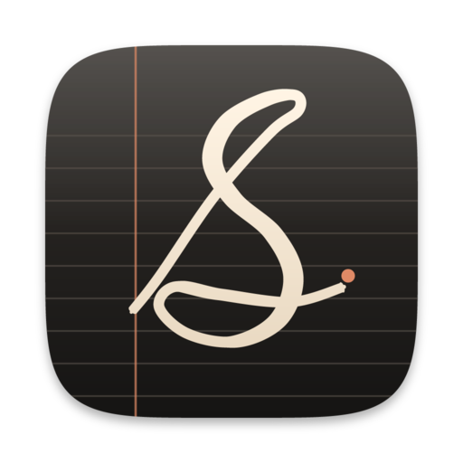

<p align="center"></p>

# Scribe

A notebook app for macOS, built around the pen. Handwriting, typed text,
images, equations and tables share one infinite page, and everything is kept
in plain folders and JSON files on your own disk.

Scribe is written in **Rust** and **SwiftUI**:

- `crates/scribe-core`: the Rust core. It holds the file format, the folder
  workspace, search, table clipboard formats, theme-aware colour, and the ink
  geometry engine that turns pen samples into pressure-varying outlines.
- `macos/`: the SwiftUI app. It holds the window, the notebook navigator, the
  page canvas (AppKit, for pen input and zoom), and the on-page objects. It
  calls the core through a small C ABI.

---

## Build

Needs Rust (`cargo`) and Xcode 16 or newer, on macOS 15 or later.

```bash
./build.sh
```

That builds the Rust core, draws the app icon, builds the app, and writes
`dist/Scribe.app`. Copy it to `/Applications` or open it in place:

```bash
open dist/Scribe.app
```

To run both test suites (Rust and Swift) as part of the build:

```bash
./build.sh --test
```

For day-to-day work you can also open `Package.swift` in Xcode once the Rust
core has been built (`cargo build --release -p scribe-core`).

## The window

Velvet dark: three soft panels on a near-black ground, with no hard edges
anywhere. Every corner is rounded, every control is a pill or a circle, and
depth comes from layered surfaces and a faint light along their top edges
rather than outlines. Page titles are set in Fraunces at its softest; the rest
of the interface uses SF Pro Rounded.

- **Notebooks** on the left, with search at the top. Collapse the panel to an
  icon rail with the button beside the window controls (⌃⌘S).
- **Pages** in the middle, as cards with each page's opening text. Hide the
  panel with its « button (⌃⌘P); drag cards to reorder.
- **The page** on the right, centred in its pane. When the open panels leave
  less room than the page needs, it zooms out just enough to fit, centred with
  even margins. Zooming by hand turns that off until you click the zoom
  percentage or choose Fit Page Width (⌘9).
- **Focus mode** (⌘\\) hides both panels and leaves the page and the tools.
- Narrow windows fold the panels into the rail automatically, with notebooks
  and pages in a popover.

Tools live in one floating **dock** at the bottom of the page: pen,
highlighter, eraser, lasso, text, four ink colours and the highlighter, and an
Insert button for tables, equations, images, pasting and paper. Click the
active pen or highlighter again for its **tray**: colours, nib width, pressure,
and a preview stroke drawn by the real ink engine. While you type, a
**format pill** floats above the text box; while you have a lasso selection, a
pill above it offers Copy, Duplicate, Recolour and Delete.

## The drawing surface

- **Pressure-varying strokes.** Ink is rendered as a true outline whose width
  follows pressure, so downstrokes thicken and strokes taper as the nib lands
  and lifts. With a drawing tablet (Wacom and friends), pressure comes straight
  from the pen. A mouse or trackpad draws at an even mid pressure.
- **Jitter smoothing.** Strokes are resampled along a Catmull-Rom spline and
  pressure is averaged over a short window, so curves read smoothly and the
  width does not pulse.
- **The tablet pen's eraser end erases**, whatever tool is selected.
- **Zoom that stays crisp.** Pinch, or ⌘-scroll, from 15% to 600%. Ink, text,
  equations and tables are redrawn at every zoom level, not scaled bitmaps.

### Tools

| Key | Tool | Notes |
|-----|------|-------|
| `P` | Pen | Pressure-sensitive; pick a colour from the tray |
| `H` | Highlighter | Even width, translucent |
| `E` | Eraser | Press again for a partial eraser that rubs out part of a stroke |
| `S` | Lasso | Select ink and objects; drag to move, corner handle to resize (⇧ keeps proportions), ⌫ to delete, ⌘C/⌘X/⌘V |
| `T` | Text | Click anywhere for a text box; objects become editable |
| `Space` | Pan | Hold it, or drag with the middle button |

| Shortcut | Action |
|----------|--------|
| ⌘N / ⇧⌘N | New page / new notebook |
| ⌘Z / ⇧⌘Z | Undo / redo, across ink, objects and typing |
| ⌘F | Search every notebook (titles, typed text, table cells) |
| ⌘B ⌘I ⌘U ⇧⌘X | Bold, italic, underline, strikethrough |
| ⌥⌘T ⌥⌘E ⌥⌘I | Insert table, equation, image |
| ⌥⌘V | Paste onto the page: images, tables (from Numbers, Excel, web pages, Markdown or CSV) or text |
| ⌘= ⌘− ⌘0 ⌘9 | Zoom in, zoom out, actual size, fit and centre the page |
| ⌃⌘S / ⌃⌘P | Collapse or expand the notebooks sidebar / hide or show pages |
| ⌘\\ | Focus mode: just the page and the dock |
| Esc | Finish typing and hand the keyboard back to the tools |

## On the page

- **Text boxes** with per-word formatting: heading styles, fonts (including a
  handwritten face), sizes, bold, italic, underline, strikethrough and colour.
  Drag the right edge to rewrap.
- **Equations** in LaTeX with a live preview, typeset natively by
  [SwiftMath](https://github.com/mgriebling/SwiftMath). Double-click to edit.
- **Tables** with a header row, resizable columns, and row and column
  insertion from the right-click menu. Copy a table out as a real table (HTML
  plus tab-separated text) or as Markdown.
- **Images** pasted, dropped in from a file, or chosen with Insert ▸ Image.
  Drag the corner to resize.

## Where your notes live

By default in `~/Documents/Scribe Notebooks`, as an ordinary folder tree:

```
Scribe Notebooks/
  My Notebook/
    notebook.json
    Quick Notes/
      section.json
      Meeting 2026-08-11.json
      assets/ab12cd.png
```

One JSON file per page, named after the page. You can browse the folder in
Finder, sync it with iCloud Drive or Dropbox, keep it in git, or read it with
any tool. The format is documented in [docs/FORMAT.md](docs/FORMAT.md). Writes
go through a temporary file and an atomic rename, so a crash or a sync client
reading mid-write never sees half a page. File ▸ Open Notebook Folder… points
Scribe at a different folder.

Deleting a page, section or notebook moves it to the Trash, so it can be
recovered.

The format is the same one the earlier Windows version of Scribe used, so
notebooks move between the two. Notebooks imported from OneNote on Windows
open here with their handwriting intact.

## Ink colour

Ink colour is adapted for display only: black handwriting shows as warm cream
on the dark page and stays black in the file, so pages written here read
correctly anywhere else, and coloured inks keep their hue, lifted to stay
legible.

## Checking the ink engine

Synthetic mouse events carry no pressure, so the ink engine is checked with a
render test that draws sample strokes through the same code path the pen uses:

```bash
dist/Scribe.app/Contents/MacOS/Scribe --render-selftest out.png
```

The sheet shows pressure response, tapering, smoothing, the highlighter, dots,
and a stroke round-tripped through the JSON format, on both themes.

## The icon

The app icon is a cursive S written in cream ink on a dark, ruled slate (the
app's own dark page), with a terracotta margin rule and a drop of ink where the
nib lifted. It is drawn by `crates/scribe-icon` using the app's own ink engine,
so the S is a real pressure-varying stroke, heavier on the downstrokes. The
small sizes get simplified artwork rather than a shrunk copy. `build.sh`
renders every size macOS needs and packs them into `AppIcon.icns`.

## Layout of the source

| Path | What is in it |
|------|----------------|
| `crates/scribe-core/src/model.rs` | The page, notebook and section formats |
| `crates/scribe-core/src/workspace.rs` | Folder workspace, manifests, search, atomic writes |
| `crates/scribe-core/src/geometry.rs` | Stroke outlines, hit testing, partial erase, lasso |
| `crates/scribe-core/src/color.rs` | Colour parsing and dark-mode ink adaptation |
| `crates/scribe-core/src/table.rs` | HTML / Markdown / TSV / CSV tables in and out |
| `crates/scribe-core/src/ffi.rs` | The C ABI (header in `crates/scribe-core/include`) |
| `crates/scribe-icon/` | The icon renderer |
| `macos/Scribe/App/` | App entry, window state, menus, pasting and inserting |
| `macos/Scribe/Canvas/` | The scroll view, page surface and ink view (pen input) |
| `macos/Scribe/Objects/` | Text boxes, rich text, images, equations, tables, floating pills |
| `macos/Scribe/Views/` | Sidebar, page list, rail, dock, pen tray, sheets, control styles |
| `macos/Scribe/Core/Theme.swift` | The velvet palette, radii, surfaces and title font |
| `macos/Scribe/Resources/Fonts/` | Fraunces (SIL Open Font License) |
| `macos/Tests/` | Swift tests |

## Known gaps

- Search covers page titles, typed text and table cells, not handwriting.
- Importing straight from OneNote needs the Windows version: OneNote for Mac
  has no API that exposes ink. Notebooks imported there open here unchanged.
- No handwriting-to-text conversion yet.
